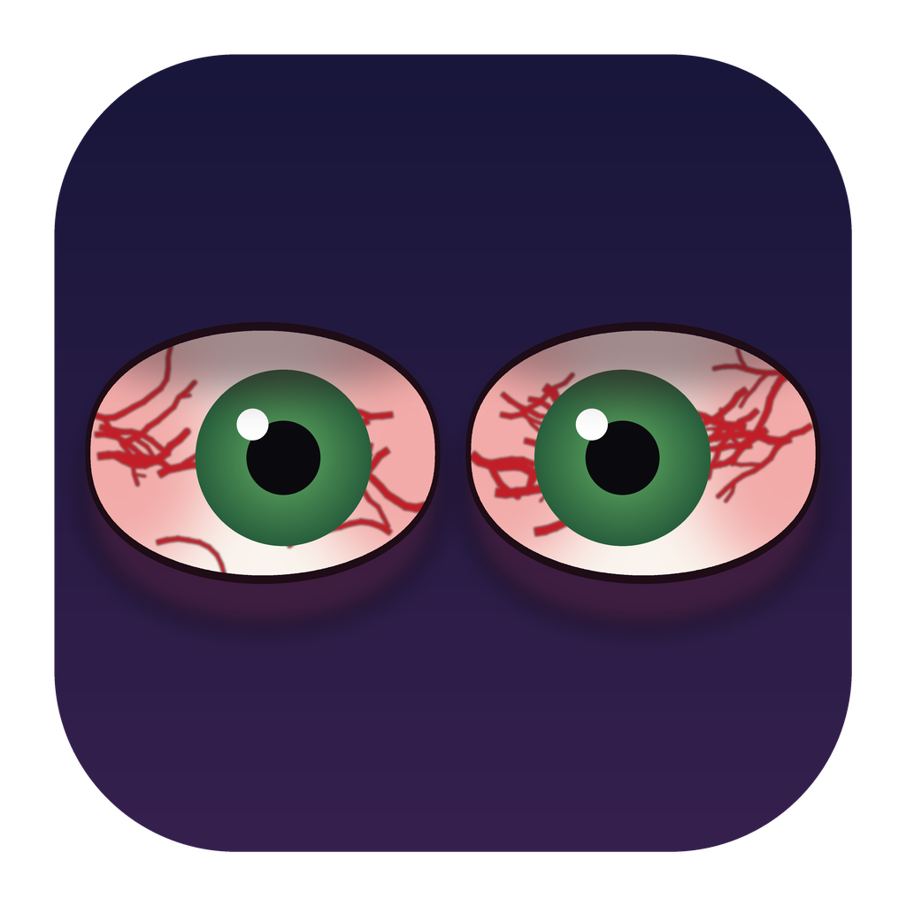

# Sleepless



A tiny utility for **Windows, macOS and Linux** that turns your screen off while preventing sleep, then puts everything back the moment you return.  

Optionally, coming back asks for a password (plus Touch ID on macOS) - checked by Sleepless itself, never through the OS lock screen, so your VPN and the rest of the session stay up. See [Coming back: a password](#coming-back-a-password-and-touch-id-on-top).

## Why not use native Windows features?
Windows 11 ties the Screen Off feature together with Sleep, so you cannot configure one without the other. Another caveat is that when the screen turns off, Windows immediately locks your computer regardless of any settings I tried. This means that tools like PowerToys Awake do not work either while the screen is off, so the computer goes to sleep using the configured OS sleep time. Very odd.

## So what is the point?
I wanted to protect my OLED monitor from burn-ins while keeping the computer active. At the same time, I wanted to keep my usual sleep timers while I'm actually away. This proved challenging with Windows.   

## How Sleepless solves this issue
1. Reads your current **sleep** and **screen-off** timeouts (both AC and battery) and saves them.
2. Sets both to **Never**.
3. Points the screensaver at Windows' built-in **blank** screensaver and starts it.
4. Waits until you dismiss the screensaver (move the mouse / press a key), detected via
   `SystemParametersInfo(SPI_GETSCREENSAVERRUNNING)`.
5. Restores your original timeouts and screensaver settings, then exits.

While this is not a true replacement for Screen Off, it's the next best thing. Obviously works much better on OLED screens since a blank screensaver basically turns off all the pixels.  


## Download
Grab the latest build from the [Releases](../../releases) page:

| Platform | File |
| --- | --- |
| Windows (x64) | `sleepless.exe` (+ `sleepless-gui.exe` for the tray icon, in the same folder) or `sleepless-windows-x86_64.zip` (both) |
| macOS (Apple Silicon + Intel) | `sleepless-macos-universal-app.zip` (Sleepless.app), `sleepless-macos-universal-gui-app.zip` (Sleepless GUI.app, menu bar icon) or `sleepless-macos-universal.tar.gz` (command line) |
| Linux (x86_64 / aarch64) | `sleepless-linux-<arch>.tar.gz` (command line + tray icon) |

## Tray / menu bar icon (`sleepless-gui`)
`sleepless-gui` puts Sleepless's eyes in the Windows taskbar tray, the macOS menu bar or the Linux system tray. **Click** them to turn the display off; **right-click** for the menu:

- **Turn display off**: runs `sleepless` (with `--asroot` if the next item is ticked). Also on a global keyboard shortcut: **Ctrl+Cmd+S** on macOS, **Ctrl+Win+S** on Windows, **Ctrl+Super+S** on Linux. It waits until you let go of the keys, so releasing them doesn't wake the screen right back up.
- **Keep awake with the lid closed (--asroot)**: remembered between runs.
- **Launch at login**: starts the tray icon when you log in. It uses each system's own per-user mechanism, so you can also see / remove it there: the `Sleepless` value under `HKCU\Software\Microsoft\Windows\CurrentVersion\Run` (Task Manager > Startup apps), `~/Library/LaunchAgents/io.github.ilyatbn.sleepless-gui.plist` (System Settings > General > Login Items) or `~/.config/autostart/sleepless-gui.desktop`.
- **Set a password to come back…** / **Remove the password**: on macOS the tray app asks you itself - two secure fields and a confirmation, then Touch ID if the machine has it - and hands the answer to the CLI over a pipe, never in the command line or the environment. On Windows and Linux it starts the CLI's own prompts and waits for them. "Remove the password" is greyed out while nothing is enrolled. The credential belongs to the CLI either way, so the menu can't drift out of sync with it, and `sleepless` started by hand obeys the same setting.
- **Quit Sleepless**: removes the icon. A screen-off session that's already running carries on until you come back.

It's only a launcher: it looks for the `sleepless` command-line tool next to itself (then on `PATH`), so keep the two together. On macOS, Sleepless GUI.app already contains it; install it the same way as Sleepless.app below, including the `xattr` step. Only one tray icon runs per user; starting it again does nothing.

If another app already owns the shortcut, the menu item just shows no shortcut. On Linux the shortcut only works in an X11 session: Wayland doesn't let apps grab keys, so bind a custom shortcut to `sleepless` in your desktop's keyboard settings instead.

On Linux the icon uses the StatusNotifierItem tray (KDE Plasma, Ubuntu, XFCE, Cinnamon...). Stock GNOME has no tray: install the *AppIndicator and KStatusNotifierItem Support* extension.

### macOS: installing the unsigned app
The app isn't signed with an Apple Developer ID, so Gatekeeper will say it *"is damaged and can't be opened"* or *"cannot be verified"*. To allow it:

1. Unzip `sleepless-macos-universal-app.zip` and drag **Sleepless.app** into **Applications**.
2. Remove the quarantine flag macOS put on the download:
   ```
   xattr -dr com.apple.quarantine /Applications/Sleepless.app
   ```
   (For the command-line binary: `xattr -d com.apple.quarantine ./sleepless`.)
3. Double-click Sleepless in Launchpad / Applications. It has no Dock icon: it covers every display with a black window and keeps the monitors on (it never turns them off, and doesn't use the screensaver, so neither brings up the lock screen). Move the mouse or press a key to come back.

#### Right-click menu
The first time you open Sleepless.app it adds a Finder **Quick Action**. It's a **Finder** item, not a Dock one (macOS only lets an app add Dock menu items while it's running). Right-click **Sleepless.app** in the **Applications folder in Finder** and pick **Quick Actions > Sleepless as root** to start it in lid mode (`--asroot`); it asks for your admin password.

It's installed into `~/Library/Services` (delete `Sleepless as root.workflow` there to remove it). The item also appears when you right-click other apps, but it always starts Sleepless. If it doesn't show up, check that it is enabled in System Settings > General > Login Items & Extensions > Finder (on older macOS: Privacy & Security > Extensions > Finder).

You can also pass options from Terminal:
```
open -a Sleepless --args --asroot
```

### Linux
```
tar xzf sleepless-linux-x86_64.tar.gz
cd sleepless-linux-x86_64
./install.sh        # installs to ~/.local (bin, icon, app-menu entry); as root: /usr/local
```

## Run

```
sleepless                  # silent, display goes off, back when you move the mouse
sleepless --debug          # log everything (Windows: to the cmd window, also /debug; macOS/Linux: stderr)
sleepless --asroot         # also allow closing the lid without anything disconnecting or sleeping
sleepless --set-password   # coming back needs a password (see below)
sleepless --help
```

### Coming back: a password, and Touch ID on top

By default the black screen goes away as soon as you touch the mouse. If you'd rather
have to prove who you are first:

```
sleepless --set-password    # asked twice, then stored
sleepless --clear-password  # back to no password
sleepless --set-passkey     # also allow Touch ID (macOS); needs a password first
sleepless --clear-passkey
sleepless --has-password    # exit 0 if something is enrolled, 1 if not (what the tray app asks)
```

On macOS the CLI never puts up a window: it asks in the terminal (echo off), which is what
running it by hand or over ssh wants. The menu-bar app is the one that shows dialogs, because
since macOS 14 a background process started by an app can't take focus from the app you are
typing in - that is why enrolment from the menu says *"Type it again to confirm"* in the
tray app's own dialog rather than in a terminal window.

Nothing here uses the OS lock screen, because that takes your VPN, your SSH sessions and
the rest of the session down with it. Sleepless draws its own black screen and checks the
answer itself:

| Platform | What coming back looks like | Passkey |
| --- | --- | --- |
| Windows | A black window over every monitor goes up *before* the screensaver starts, so the keypress that ends the screensaver reveals that window instead of your desktop. Type the password, Enter. | not yet |
| macOS | The black windows stay up, and the one under your pointer carries the password box: it is part of the black window itself, so it holds the keyboard (just type and press Return). The other displays stay plain black. Since macOS 14 the system decides which app may be frontmost, so if it didn't hand this one the keyboard, the box says **"Click this screen to type your password"** - until you click, typing would go to whatever app *is* active, and a password typed into a terminal is a shell command. Escape only clears the box. | Touch ID is tried with the box already up, and only while this app owns the keyboard; if the sensor can't help, the field is simply still there |
| Linux | The display comes back first (the compositor decides when DPMS does), then an askpass dialog - or the terminal, if Sleepless was started from one. | none |

The password is stored as a PBKDF2-HMAC-SHA256 hash with a random salt (600 000 rounds),
never in the clear: `HKCU\Software\Sleepless\password` on Windows,
`~/Library/Application Support/Sleepless/sleepless.conf` on macOS and
`~/.config/sleepless/sleepless.conf` on Linux (written `0600`). Wrong answers cost
progressively more time - on macOS the box counts it down ("Too many attempts - wait
8s") and stays responsive while it does, so locking the session still works. Clearing
the prompt (Escape, Cancel) doesn't let you in and doesn't cost you anything either.

**What it is and isn't.** It keeps whoever wanders up to your machine off a screen that
Sleepless deliberately left unlocked - it is not a security boundary. It doesn't try to
hide from someone with admin rights, and **killing the Sleepless process is a supported
way out**: on Windows the power settings it changed are restored by a registry restore
point the next time Sleepless starts, and on macOS/Linux the helpers that hold the
no-sleep state go away with the process. When you want the real thing, lock the session
yourself (`Win+L` / `Ctrl+Cmd+Q`); Sleepless never triggers that for you.

**Locking the session always wins.** Sleepless watches for the OS taking the session over
and gets out of the way immediately - the black windows come down and everything it changed
is put back:

| Platform | What it listens for |
| --- | --- |
| macOS | the session being resigned (`NSWorkspaceSessionDidResignActiveNotification`) and `com.apple.screenIsLocked` |
| Windows | `WM_WTSSESSION_CHANGE` with `WTS_SESSION_LOCK`, through a message-only watch window; logoff/shutdown is allowed through too |
| Linux | logind's `LockedHint` for the session, and the desktop screensaver going active, polled every few seconds |

So if a prompt ever fails to appear - or a run gets stuck for any reason - **lock the
machine and Sleepless ends**. That's a deliberate safety valve, not a fallback.

If a build ever misbehaves in that area, macOS's screen-lock watcher can be switched off
without rebuilding anything: `SLEEPLESS_NO_SCREEN_LOCK_WATCH=1 sleepless …`. The log says it
was disabled; everything else, including the password prompt, keeps working - only
`Ctrl+Cmd+Q` stops ending the run by itself. On Linux the lock check starts once the display
is actually off, so a screensaver that was already showing doesn't cut the run short.

### If something doesn't work: the log file

Both Sleepless programs append to one plain-text log, started whether or not `--debug`
was used (a session launched from the menu bar has no console to print to):

| Platform | File |
| --- | --- |
| Windows | `%LOCALAPPDATA%\Sleepless\sleepless.log` |
| macOS | `~/Library/Logs/Sleepless/sleepless.log` |
| Linux | `~/.local/state/sleepless/sleepless.log` (`$XDG_STATE_HOME`) |

It records each run (pid, arguments), what the tray app asked the CLI to do and the CLI's
exit code, which prompt was shown, which button you pressed, whether a passkey was
offered, and what happened when the screen was unlocked. Passwords themselves are never
logged - only how long they were. The file is capped at 512 KiB and starts over;
`SLEEPLESS_LOG=/some/path` sends it somewhere else.

To capture a problem: reproduce it, then send the whole file. For a menu-bar session, the
lines tagged `sleepless-gui` are the tray app and the rest come from the CLI it started.

On macOS the passkey is Touch ID through `LocalAuthentication`, which does the verifying -
Sleepless stores nothing from it beyond a marker. It's strictly an addition: a password has
to be enrolled first, and if the sensor isn't available, the prompt is cancelled, or the
system won't talk to us, you get the password box. Windows Hello would mean the WebAuthn
C API (attestation and assertion blobs, CBOR and COSE parsing, an ECDSA signature check),
which isn't in this build; the password carries the lock screen there on its own.

### `--asroot`: closing the lid
Normally closing a laptop lid suspends it, which drops Wi-Fi, SSH sessions, downloads, etc. With `--asroot` the machine keeps running with the lid shut until you come back:

| Platform | What it does | Needs |
| --- | --- | --- |
| macOS | `pmset -a disablesleep 1` (the only switch that stops a MacBook sleeping on lid close), previous value restored on exit | Your admin password: asked in the terminal via `sudo`, or with the standard macOS admin dialog when launched as the app |
| Linux | Adds `handle-lid-switch` to the logind inhibitor lock, taken as root | Your password via `sudo` (terminal) or `pkexec` (graphical prompt) |
| Windows | Sets "When I close the lid" to *Do nothing* (AC and battery) on the active power plan, restored on exit | Nothing, this setting doesn't need admin rights on Windows |

Run Sleepless as your **normal user** and let it ask for the password; don't wrap it in `sudo` yourself. Only a small helper runs as root, and the rest of Sleepless has to stay in your desktop session to control the display. The root helper watches the Sleepless process and undoes its change as soon as Sleepless exits, even if it's killed or crashes.

Coming back: open the lid and move the mouse / press a key. Sleepless restores everything and exits. With the lid shut, the machine keeps running on battery and keeps the heat in, so think twice before putting it in a bag.

## Build
You'll need the Rust toolchain.

```
cargo build --release
```

The binary will be at `target/release/sleepless` (`sleepless.exe` on Windows, which also gets the icon embedded; that step needs the MSVC toolchain's `rc.exe`, which comes with the default Windows setup).

The tray app is a separate crate in `gui/`; `cargo build --release --workspace` builds both (`target/release/sleepless-gui`). It has no system library dependencies on any platform.

macOS app bundle (universal):
```
rustup target add aarch64-apple-darwin x86_64-apple-darwin
cargo build --release --target aarch64-apple-darwin
cargo build --release --target x86_64-apple-darwin
lipo -create -output sleepless target/{aarch64,x86_64}-apple-darwin/release/sleepless
packaging/macos/build-app.sh sleepless 0.3.0 .     # -> ./Sleepless.app
```
For `Sleepless GUI.app`, build with `--workspace`, `lipo` `sleepless-gui` the same way, then `packaging/macos/build-gui-app.sh sleepless-gui sleepless 0.3.0 .`.

The icon is generated by `python3 assets/make_icon.py` (needs Pillow), which writes `icon.png`, `icon-512.png`, `icon.ico`, `icon.icns` and the tray icons `tray.png` / `tray-template.png` (macOS menu bar) into `assets/`.

GitHub Actions (`.github/workflows/release.yml`) builds Windows, macOS (universal binary + `.app`) and Linux (x86_64 + aarch64) on every push and pull request, and publishes a `v<version>` release from `Cargo.toml` on pushes to `main`.

## How it works, briefly

### Windows
- **Timeouts**: `PowerGetActiveScheme` + `PowerReadACValueIndex`/`PowerReadDCValueIndex` on the
  `GUID_STANDBY_IDLE` (sleep) and `GUID_VIDEO_POWERDOWN_TIMEOUT` (screen) settings, then
  `PowerWriteACValueIndex`/`PowerWriteDCValueIndex` + `PowerSetActiveScheme` to apply `0` ("Never").
  This only touches your *active* power plan and does not require admin rights, same as dragging
  the sliders in Settings > Power & sleep. `--asroot` does the same for the lid close action.
- **Screensaver**: temporarily rewrites `HKCU\Control Panel\Desktop\SCRNSAVE.EXE` to
  `%WINDIR%\System32\scrnsave.scr` (the built-in blank saver), enables it via
  `SPI_SETSCREENSAVEACTIVE`, and force-starts it with the standard
  `SendMessage(HWND_BROADCAST, WM_SYSCOMMAND, SC_SCREENSAVE, 0)` trick.
- **Waiting**: polls `SPI_GETSCREENSAVERRUNNING` once a second. It first waits (up to 5s) for the
  flag to go *true* to avoid a startup race, then waits for it to go back to *false*.
- **No UI**: built with `#![windows_subsystem = "windows"]`. With `/debug`, it calls
  `AttachConsole(ATTACH_PARENT_PROCESS)` to reuse the calling cmd window (falling back to
  `AllocConsole` if launched without a console, e.g. double-clicked), then logs manually via
  `WriteConsoleW` rather than `println!`, since a GUI-subsystem process has no valid stdout handle
  until a console is attached.
- **Password gate**: a `WS_POPUP` window, topmost and spanning the virtual desktop, is created
  before `SC_SCREENSAVE` is broadcast, with the password box and Unlock button hidden. When the
  saver ends, that window is what's revealed. `IsDialogMessageW` in its message loop turns Enter
  into a press of the default button; Escape and Alt+F4 are ignored while locked, and a 200 ms
  `WM_TIMER` re-asserts topmost, foreground and focus. The prompt itself is a `WS_POPUP` with an
  `EDIT` (`ES_PASSWORD`) - not a dialog resource, so no template to ship.
- **Restore point**: what the run is about to change is written to
  `HKCU\Software\Sleepless\restore` before `PowerWrite*ValueIndex` touches it and deleted once
  the values are back; a run that starts with that key present puts them back first. So the
  process can be killed without the timeouts getting stuck on "Never".

### macOS
- **Stay awake**: `caffeinate -d -i -m -s -w <pid>`: power assertions against display and system sleep that end by itself when Sleepless exits. The monitors are never turned off, because on macOS that's what brings up the lock screen.
- **Black screen**: a borderless black `NSWindow` on every display at screensaver window level (above the menu bar, Dock and full-screen apps), with the cursor hidden. Not the system screensaver: on recent macOS that shows the lock-screen clock and wallpaper, and often asks for the password afterwards.
- **Waiting**: polls CoreGraphics' `CGEventSourceSecondsSinceLastEventType` (HID idle time) and exits as soon as it drops, i.e. on any keyboard/mouse input, which also removes the windows.
- **Password gate**: AppKit needs the main thread, so the input-watching thread only sets a flag; the main thread pumps the event queue itself, and asks there. The prompt is an `NSAlert` with an `NSSecureTextField` accessory view - the alert's buttons run the modal loop, which is what makes Return submit and Escape harmless - raised to screensaver window level + 1 so the black windows never uncover. With nothing enrolled the ordinary `NSApplication.run()` path is used.
- **Touch ID**: `LAContext.canEvaluatePolicy` / `evaluatePolicy` through the Objective-C runtime (Linking `LocalAuthentication.framework` so the class is actually loaded). Its reply block is called back on the main queue, which is the thread that asked, so the run loop is pumped until it fires; a timeout falls through to the password box.

### Linux
- **Stay awake**: `systemd-inhibit --mode=block --what=sleep:idle` (plus `handle-lid-switch` with `--asroot`) wrapped around a tiny shell loop that exits when Sleepless does. `elogind-inhibit` works too.
- **Display off**, depending on the session:
  - **GNOME** (Wayland or X11): Mutter's `org.gnome.Mutter.DisplayConfig.PowerSaveMode` over D-Bus (`gdbus`); user activity via `org.gnome.Mutter.IdleMonitor`.
  - **KDE Plasma** (Wayland or X11): `kscreen-doctor --dpms off/on`; user activity via `org.freedesktop.ScreenSaver.GetSessionIdleTime`.
  - **Other X11** sessions: `xset dpms force off`, then waits for the X server to report the monitor back on.
  - Anything else (e.g. wlroots compositors like Sway): the display is left alone, but the machine is kept awake until you press Enter / Ctrl+C.
- **Password gate**: the power settings are restored only after the password is right. The prompt is `zenity --password` / `kdialog --password` when there's a desktop session, or the terminal with the echo switched off through `stty` when Sleepless was started from one. Unlike the other platforms the desktop is visible while it asks: the compositor decides when DPMS comes back on input, and there's no portable way for an ordinary process to sit above it.

## Caveats / things worth knowing
- **Windows: restore point**: the timeouts Sleepless changes are saved to `HKCU\Software\Sleepless\restore`
  and put back when the run ends - including a run that was killed, which restores them at the start of
  the next one. So nothing is stuck on "Never", but a killed session does leave the settings alone until
  Sleepless runs again.
- **The come-back password is a deterrent**: it stops whoever is in front of the machine from walking
  into an unlocked session that Sleepless blacked out for you. It doesn't resist anyone with admin
  rights, and `sleepless` can always be killed to get past it - that's deliberate, because the OS lock
  screen (`Win+L` / `Ctrl+Cmd+Q`) is the thing that actually protects the session, and it also protects
  your VPN and everything else the way it's meant to.
- **Lock screen**: if your OS is set to require a password after the display turns off / the
  screensaver starts, you'll still get the lock screen when you come back. That's by design;
  Sleepless doesn't touch security settings. (macOS avoids both: the display stays on and the
  screensaver isn't used, so this doesn't apply there.)


#### Code generated almost entirely using Claude.